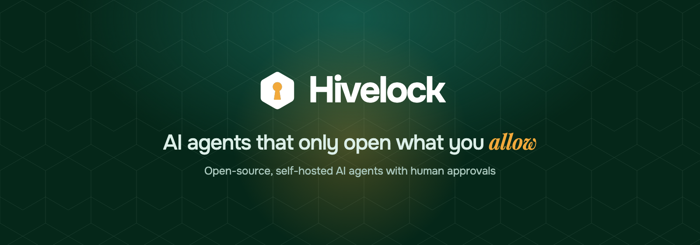
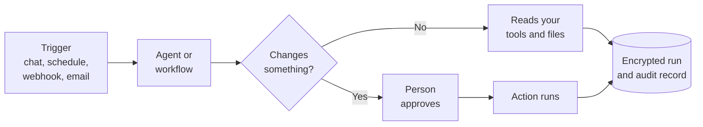

<div align="center">



<h3>Open-source, self-hosted AI agents with human approvals</h3>

<p>Build agents and workflows, connect them to your business tools,<br>and stay in control of every action that matters.</p>

<p>
  <a href="LICENSE"></a>
  
  
  
  
</p>

<p>
  <a href="#-quick-start"><strong>Quick start</strong></a> &nbsp;·&nbsp;
  <a href="#-features"><strong>Features</strong></a> &nbsp;·&nbsp;
  <a href="#-security"><strong>Security</strong></a> &nbsp;·&nbsp;
  <a href="#-editions"><strong>Editions</strong></a> &nbsp;·&nbsp;
  <a href="#-documentation"><strong>Docs</strong></a>
</p>

</div>

---

## ✦ Why Hivelock

AI agents are most useful when they can reach real systems, which is also when mistakes matter most. Hivelock gives every agent clear limits, so your team can automate work without handing over control.

<table>
<tr>
<td width="33%" valign="top">

**🔐 Least access**

Each agent gets only the actions you choose. Credentials stay on the server, so the model never sees them.

</td>
<td width="33%" valign="top">

**🙋 People decide**

In chat, actions that change data wait for approval. In workflows, you place approval steps where you need them.

</td>
<td width="33%" valign="top">

**🧾 Proof of work**

Runs, tool calls and decisions are recorded, and the audit log is hash-chained so a changed record shows up.

</td>
</tr>
</table>

## ✦ Features

| | Feature | What you get |
|---|---|---|
| 🧩 | **Visual workflow builder** | Drag agents, conditions, approvals and connector steps onto a canvas |
| 🤖 | **Custom agents** | Describe an agent and review the draft, with skills and approved memory |
| 📚 | **74+ templates** | Starting points for 11 business areas, installed as drafts |
| 🔌 | **26+ connectors** | Mail, files, databases, chat, CRM, developer tools and remote MCP servers |
| ⏱️ | **Triggers** | Manual, schedule, signed webhook and incoming email |
| 🧠 | **Any AI model** | Any OpenAI-compatible server, with fallback order and local model support |
| 🔎 | **Document search** | Search PDF, Excel, CSV and text files, with the source named |
| 💬 | **Live chat and WhatsApp** | Streaming answers in the app, and WhatsApp channels |
| 🕘 | **Version history** | Compare and restore every saved workflow |
| 📈 | **Observability** | Live runs, costs, traces and repeatable agent checks |

## ✦ How it works



## ✦ Quick start

**You need:** Node.js 22 or newer, PostgreSQL 18 with pgvector, and a key for any OpenAI-compatible AI model, or a local model server.

```bash
# 1. Install
npm install
cp .env.example .env

# 2. Fill in the database, secret and admin settings in .env

# 3. Prepare the database and build the web app
npm run db:migrate
npm run web:build

# 4. Start the app and the worker, each in its own terminal
npm run platform
npm run worker
```

Open **http://localhost:4320** and sign up with the address in `BOOTSTRAP_ADMIN_EMAIL`. Then add an AI model under **Settings**.

<details>
<summary><strong>Run with Docker Compose</strong></summary>

```bash
cp .env.production.example .env.production
cp .env.migrate.example .env.migrate
# Fill in both files, then:
docker compose --env-file .env.production --env-file .env.migrate up -d --build
```

The stack includes PostgreSQL with pgvector, the app, a worker and Caddy for TLS. See the [developer guide](docs/developer-guide.md).

</details>

## ✦ Security

Security is part of the design, not a paid extra. Every edition keeps these protections:

- **Workspace isolation** with PostgreSQL row-level security
- **AES-256-GCM encryption** for secrets and run data, with a key for each workspace
- **Mandatory two-step sign-in** for password accounts
- **Network guard** that stops connectors reaching private addresses by default
- **Reviewed MCP tools** that stay off until someone approves them
- **Tamper-evident audit log**

Hivelock is self-tested with the open-source [Strix](https://github.com/usestrix/strix) penetration testing tool. It has not yet had an independent third-party penetration test, and it holds no certification. See the [limits and known risks](docs/developer-guide.md#before-calling-this-production-ready).

To report a vulnerability, email **sales@shichifukutekx.ae**. Please do not open a public issue.

## ✦ Editions

| | **Community** | **Self-hosted Licensed** | **Hosted** |
|---|---|---|---|
| **Licence** | AGPL-3.0 | Commercial | Service terms |
| **Price** | Free | Contact us | From $29 a month, planned |
| **Limits** | 1 workspace, 5 people, 5 agents, 10 workflows | None | By plan |
| **Connectors** | 6 core connectors | All connectors | All connectors |
| **Single sign-on** | No | Yes | Business plan |
| **Approvals, audit and encryption** | ✓ | ✓ | ✓ |

See [editions](docs/editions.md) for the full comparison.

## ✦ Built with

<p>
  
  
  
  
  
  
</p>

Hono · better-auth · pg-boss · pgvector · React Flow · Model Context Protocol

## ✦ Documentation

| Guide | What it covers |
|---|---|
| [Developer guide](docs/developer-guide.md) | Setup, architecture and operations |
| [Editions](docs/editions.md) | Community, licensed and hosted |
| [Upgrades](docs/upgrades.md) | Safe upgrades and rollbacks |
| [High availability](docs/high-availability.md) | Replicas, fair sharing of workers, and stopping safely |
| [Monitoring](docs/monitoring.md) | Metrics, alerts, dashboards, logs and error reporting |
| [Disaster recovery](docs/disaster-recovery.md) | Backups, restore drills and runbooks |
| [Key rotation](docs/key-rotation.md) | Changing the master key |
| [Extensions](docs/extensions.md) | How a package adds to the core |

## ✦ Contributing

Issues and ideas are welcome. Outside contributions need an agreement before they can be accepted: see [CONTRIBUTING](CONTRIBUTING.md). Run the checks before you share a change:

```bash
npm run typecheck
npm test
```

## ✦ Licence

The Hivelock core is open source under the [GNU Affero General Public License v3.0](LICENSE). The paid package is under a commercial licence, which is also available for support or terms other than the AGPL. Contact **sales@shichifukutekx.ae**.

The Hivelock name and logo are not covered by the code licence.

---

<div align="center">


<sub><strong>Hivelock</strong> is a product of <a href="https://www.shichifukutekx.ai">www.shichifukutekx.ai</a></sub>

</div>
